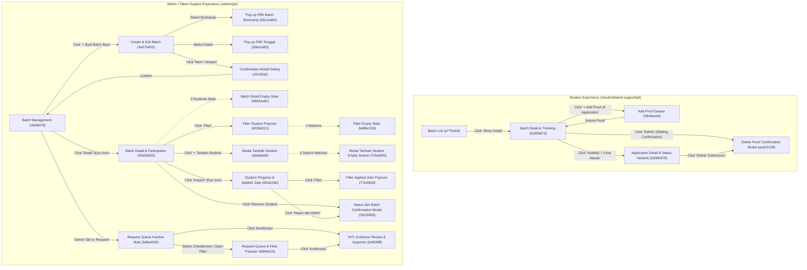

# Screen Inventory — JAT Hybrid IDP

> **Source of Truth Disclosure:**
> This inventory catalogs all screens, interactive states, documentation nodes, and reference image instances retrieved via the Google Stitch MCP from Project `projects/5548734684114454711` (**"Job Application Tracker UI"**).
> All exported HTML and high-resolution PNG screenshot assets have been saved locally under `design-reference/stitch/html/`, `design-reference/stitch/screens/`, and `design-reference/stitch/docs/` (indexed in `design-reference/stitch/manifest.json`).

---

## 1. Inventory Summary

- **Stitch Project Resource Name:** `projects/5548734684114454711`
- **Project Title:** `Job Application Tracker UI`
- **Design System Asset:** `assets/53884af2d33c4172a6c129c0419edce3` (*"Dibimbing LMS - Job Application Tracking"*)
- **Total Nodes in Stitch Canvas:** 52 screen instances:
  - **20 Active Generated UI Screens** (with full HTML exports + high-res PNG screenshots)
  - **7 Hidden / Base Iterative UI Screens** (5 unique screen IDs downloaded via `get_screen` + 2 additional iterative table variants in `list_screens`)
  - **4 Documentation Canvas Nodes** (3 active markdown/plain-text specs + 1 hidden draft)
  - **20 Uploaded Reference Image Instances** (`SCREEN_INSTANCE` nodes corresponding to the cropped PDF screenshots in `design-reference/student/`, `design-reference/admin/`, and `design-reference/request/`)

---

## 2. Student Experience Screens (`Actor: Student`)

| Stitch Screen ID | Screen Title | Proposed Route / Surface Type | Purpose | Key Components & UI Elements | Supported States & Interactive Triggers | Local Saved Assets (`design-reference/stitch/`) |
|---|---|---|---|---|---|---|
| `a77fcde96d034478948b467133c09b3a` | **Student - JAT Batch List** | `/student/talent-support/jat` (Full Page) | Displays all JAT batches accessible to the logged-in Student, showing cohort schedule, target fractions, and entry actions. | • Student LMS Left Sidebar (`Talent Support` > `Job Application Tracking` active) • Top course header (`UI/UX Design Batch 17`) • Sub-navigation tabs (`Layanan Talent Support`, `Job Connector`, `Recording Practice`, `Job Application Tracking`) • Batch List Table (`Batch Name`, `Phase 1 Date`, `Phase 2 Date`, `Target Progress` pill `8/10`, `Status`, `Action` button `Show Detail`) • Pagination footer (`Show: 10 Data`) | • **Active Batch State:** `Show Detail` button enabled in primary cyan (`#0BB1CB`). • **Inactive / Upcoming State:** Muted badge, disabled or secondary action. • **Trigger:** Click `Show Detail` ──► navigates to `Student - JAT Batch Detail & Tracking` (`91859673`). | • `screens/student-jat-batch-list-a77fcde9.png` • `html/student-jat-batch-list-a77fcde9.html` |
| `918596734f4148218b40ed1af860711d` *(Base hidden: `18b39f4786834e298d2faa8bf49e1607`)* | **Student - JAT Batch Detail & Tracking (Enhanced)** | `/student/talent-support/jat/:batchId` (Full Page) | Main Student dashboard for a specific JAT batch, displaying overall progress, Phase 1 & Phase 2 date-range/job-level quotas, and the Student's `Applied Jobs` table. | • Back link (`Kembali ke Daftar Batch JAT`) • Batch Header + `Active Tracking` badge + `Export Riwayat (CSV)` & `Bantuan Mentor` buttons • 4 Top KPI Summary Cards: `Target Keseluruhan` (`19/40`, `47.5%` circular ring), `Approved / Accepted`, `Waiting Confirmation`, `Declined / Need Revision` • Multi-Phase Breakdown Cards (`Phase 1` active with Date Range 1 & Date Range 2 cards showing `Junior Level` & `Senior Level` progress bars; `Phase 2` upcoming/locked) • `Applied Jobs` Section: Search bar, `Filter Status` dropdown/popover, primary CTA `+ Add Proof of Application` • Applied Jobs Table (`Company`, `Role & Level`, `Date Applied`, `Phase / Range`, `JAT Status`, `Action`) | • **Phase States:** `Achieved` (`Tercapai`), `In Progress`, `Not Achieved` (`Tidak Tercapai`), `Upcoming` (`Belum Dimulai`). • **Submission Row States:**   - `Waiting Confirmation`: View (`visibility`) + Delete (`delete`) enabled.   - `Accepted`: View (`visibility`) + Lock (`lock`) icon (deletion disabled).   - `Declined`: View (`visibility`) + `"Lihat Alasan →"` link + `Re-submit` (`refresh`) icon. • **Triggers:**   - Click `+ Add Proof of Application` ──► opens Drawer `384daeed`.   - Click `visibility` / `"Lihat Alasan"` ──► opens Detail Drawer `2d360978`.   - Click `delete` ──► opens Delete Modal `acd13109`. | • `screens/student-jat-batch-detail-tracking-enhanced-91859673.png` • `html/student-jat-batch-detail-tracking-enhanced-91859673.html` • *(Base: `...-18b39f47.png/.html`)* |
| `384daeedae4842fba4fb6790c0e8e043` *(Base hidden: `5e9e7e6185de48f99a66706087d6995c`)* | **Student - JAT Add Proof of Application Drawer (Enhanced)** | Slide-over Right Drawer (`580px` width) over `/student/talent-support/jat/:batchId` | Allows Student to submit a new job application record along with screenshot proof and required job attributes. | • Dimmed blurred backdrop (`bg-slate-900/50 backdrop-blur-md`) • Sticky Drawer Header (`Add Proof of Application`, `JAT Batch 2 • Talent Support` pill, close `✕`) • Informational Requirements Banner (`JPG, JPEG, PNG maksimal 5MB`, HITL verification notice) • 2-Column Form Grid:   1. `Date Applied *` (date input constrained to active range; helper warning against future/out-of-range dates)   2. `Role Applied *` (text input)   3. `Company Name *` (text input with icon)   4. `Company Location *` (text input with icon)   5. `Position *` (select: `Full-time`, `Internship`, `Contract`, `Freelance`)   6. `Years of Experience *` (text input, e.g., `0-1 Tahun`)   7. `Job Level *` (select: `Junior Level`, `Mid Level`, `Senior Level`, `Lead / Managerial`)   8. `Work System *` (select: `Remote / WFH`, `Hybrid`, `Onsite`)   9. `Link Job Vacancy *` (URL input)   10. `Upload Proof of Application *` (dashed cyan drag-and-drop zone + uploaded file preview pill `bukti_lamaran_pertamina.png · 1.8 MB`) • Sticky Footer (`Batal` + `Submit Bukti Lamaran`) | • **Default / Filled State:** Pre-populated synthetic fields and uploaded file pill. • **Focus & Validation States:** Cyan focus ring (`focus:ring-[#0bb1cb]`), required field indicators (`*`), `accept="image/png, image/jpeg, image/jpg"`, date `min`/`max` constraints. • **Loading / Success State (in script):** Button transitions to spinning `Mengirim Bukti...` then `Berhasil Terkirim!` before closing drawer. | • `screens/student-jat-add-proof-of-application-drawer-enhanced-384daeed.png` • `html/student-jat-add-proof-of-application-drawer-enhanced-384daeed.html` • *(Base: `...-5e9e7e61.png/.html`)* |
| `2d36097898c1414292eb4cf45aad180c` | **Student - JAT Application Detail & Status Variants** | Slide-over Right Drawer (`560px` / `max-w-xl`) + Embedded Delete Modal | Displays the read-only details of a Student's submitted job application, uploaded proof image, validation status, and Talent Support feedback note. | • Sticky Drawer Header (`Application Detail`, Company & Role title, close `✕`) • Interactive Status Prototype Switcher (`Accepted`, `Waiting Review`, `Declined`) • Status Callout Banner:   - `Accepted`: Emerald banner with verification date & milestone confirmation.   - `Waiting Confirmation`: Amber banner with submission date & 1x24h review notice.   - `Declined`: Rose banner with explicit rejection reason (*"The uploaded screenshot is cropped and company name is unreadable..."*). • `Submitted Job Information` 2-column read-only cards (`Date Applied`, `Role Applied`, `Company Name`, `Company Location`, `Position`, `Years of Experience`, `Job Level`, `Work System`, clickable `Link Job Vacancy`) • `Proof of Application Evidence` preview card + Human review verification tag • Sticky Footer (`Delete Submission` + `Done`) | • Supports toggling all 3 validation states (`Accepted`, `Waiting Confirmation`, `Declined`) in the drawer. • **Trigger:** Click `Delete Submission` ──► opens embedded `Delete Proof of Application` modal. | • `screens/student-jat-application-detail-status-variants-2d360978.png` • `html/student-jat-application-detail-status-variants-2d360978.html` |
| `acd1310968e246268e1d56fea1c76283` | **Student - JAT Delete Proof Confirmation Modal (Enhanced)** | Centered Modal Dialog (`max-w-md` / `440px`) over Student Batch Detail | Confirms destructive deletion/retraction of a Student's submitted proof of application before verification. | • Red warning icon badge • Modal Title (`Delete Proof of Application` / `Hapus Bukti Lamaran`) • Confirmation prompt naming specific company & role (`Pertamina – UI/UX Designer`) and impact note • Action buttons (`Cancel` / `Batal` neutral button + `Delete` / `Ya, Hapus Bukti` destructive red button `#DC2626`) | • **Cancel:** Dismisses modal without deleting data. • **Confirm Delete:** Removes submission and closes modal. | • `screens/student-jat-delete-proof-confirmation-modal-enhanced-acd13109.png` • `html/student-jat-delete-proof-confirmation-modal-enhanced-acd13109.html` |

---

## 3. Admin / Talent Support Experience Screens (`Actor: Admin / Talent Support`)

### 3.1 Batch & Schedule Management

| Stitch Screen ID | Screen Title | Proposed Route / Surface Type | Purpose | Key Components & UI Elements | Supported States & Interactive Triggers | Local Saved Assets (`design-reference/stitch/`) |
|---|---|---|---|---|---|---|
| `c9da5cf3b4ae45d1a606325f68619642` | **Admin - JAT Batch Management** | `/admin/jat/batches` (Full Page + Quick Drawer/Modal) | Primary Admin landing page for listing, searching, and creating JAT batches, plus switching to the `Request` queue. | • Admin Left Sidebar (`Talent & Career` > `Job Application Tracking` active) • Top sub-navigation pill switcher: `Daftar Batch JAT` (active) vs `Request` (with pending count badge `4`) • Search bar (`Cari nama batch...`) + Primary CTA `+ Buat Batch Baru` • Batch Table (`Batch Name` with status dot, `Phase 1 Start`, `Phase 1 End`, `Phase 2 Start`, `Phase 2 End`, `Total Peserta` pill, `Action` eye button) • Pagination footer (`Show: 10 Data`) • 3 Bottom Cohort Health Summary Cards (`Total Active Cohorts`, `Enrolled Participants`, `Application Submission Rate` `84.2%`) | • **Triggers:**   - Click `+ Buat Batch Baru` ──► navigates to `/admin/jat/batches/create` (`4e57b402`) or opens quick drawer.   - Click `Request` tab ──► navigates to `/admin/jat/requests` (`9df4e619`).   - Click row `visibility` eye button ──► navigates to Batch Detail (`93d2b663`). | • `screens/admin-jat-batch-management-c9da5cf3.png` • `html/admin-jat-batch-management-c9da5cf3.html` |
| `4e57b4029a0a430cb5f54f6f77c2e84a` | **Admin - Create & Edit Batch JAT** | `/admin/jat/batches/create` & `/admin/jat/batches/:id/edit` (Full Page Form) | Full configuration form for creating or editing a JAT Batch, linking bootcamp cohorts, and defining Phase 1 and optional Phase 2 date ranges and job-level targets. | • Breadcrumb & Back link (`Kembali ke Daftar Batch JAT`) • **General Batch Info Card:** `Nama Program / Batch JAT *` text input + `Pilih Batch Bootcamp Terafiliasi *` multi-select tag selector • **Phase 1 (Wajib) Container:**   - Dynamic `Date Range 1`, `Date Range 2` blocks   - `Start Date` & `End Date` date pickers   - `Target Job Level` dynamic repeater rows (`Job Level` select: `Junior Level`, `Mid Level`, `Senior Level` + numeric quota input `Job Applied` + delete row button + `+ Add Target Job Level` link)   - `+ Add Date Range` full-width outline button • **Phase 2 (Opsional) Container:** Same multi-range, multi-target structure marked optional • **Ringkasan Beban Lamaran Widget:** Displays total calculated application commitment per student (`13 Lamaran Kerja`) • Footer Actions (`Batal` + `Next` / `Simpan Batch`) | • **Dynamic Repeater States:** Add/remove `Target Job Level` rows and `Date Range` blocks dynamically. • **Triggers:**   - Click Bootcamp selector ──► opens Cohort Popover (`b9c1ad84`).   - Click Date input ──► opens Date Picker Popover (`2bbe1483`).   - Click `Next` / `Simpan` ──► opens Confirmation Modal (`cf1165af`). | • `screens/admin-create-edit-batch-jat-4e57b402.png` • `html/admin-create-edit-batch-jat-4e57b402.html` |
| `b9c1ad844c6a45918cfbac6216ee351c` | **Admin - Create Batch JAT (Pop-up Pilih Batch Bootcamp)** | Dropdown Popover over Create/Edit Batch | Multi-select dropdown allowing Admin to associate one or more Bootcamp cohorts with the JAT batch. | • Search input (`Cari batch bootcamp...`) • Filterable list of bootcamp cohorts with checkboxes (`UI/UX Design Batch 21`, `UI/UX Design Batch 22`, `Fullstack Web Batch 14`, `Data Science Batch 19`, etc.) • Student count badge per cohort • Selected counter + `Reset` & `Terapkan Pilihan` buttons | • Multi-select active/checked state with removable chips in the parent input field. | • `screens/admin-create-batch-jat-pop-up-pilih-batch-bootcamp-b9c1ad84.png` • `html/admin-create-batch-jat-pop-up-pilih-batch-bootcamp-b9c1ad84.html` |
| `2bbe1483ef6c4cd6bc2ff37419f3f615` | **Admin - Create Batch JAT (Pop-up Pilih Tanggal)** | Date Range Picker Popover over Create/Edit Batch | Interactive two-month calendar popover for selecting a valid `Start Date` and `End Date` for a phase date range. | • Quick range presets (`7 Hari`, `14 Hari`, `30 Hari`, `Bulan Ini`) • Dual-month calendar grid (`Maret 2025` & `April 2025`) with highlighted continuous range between start and end dates • Validation rule notice (`Start Date <= End Date`) • Selected range summary + `Batal` & `Pilih Rentang Tanggal` CTA | • Prevents selecting an End Date earlier than Start Date (BR-03). | • `screens/admin-create-batch-jat-pop-up-pilih-tanggal-2bbe1483.png` • `html/admin-create-batch-jat-pop-up-pilih-tanggal-2bbe1483.html` |
| `cf1165af81c341fdb878b4c798a3ea15` | **Admin - Create Batch JAT (Confirmation Modal Dialog)** | Centered Confirmation Modal (`max-w-lg` / `480px`) over Create/Edit Batch | Reviews batch schedule and target quotas and requires explicit confirmation before saving/updating a batch. | • Amber/Cyan confirmation icon badge • Modal Title (`Simpan & Terapkan Jadwal Batch?` / `Konfirmasi Perubahan Batch`) • Summary box (`Nama Batch`, `Batch Bootcamp Terafiliasi`, `Total Periode`, `Target Kelulusan`) • Consequential impact warning (recalculation of student progress & date synchronization per BR-08 / BR-14) • Actions (`Periksa Kembali` + `Ya, Simpan & Aktifkan`) | • **Cancel (`Periksa Kembali`):** Returns to form. • **Confirm (`Ya, Simpan & Aktifkan`):** Commits configuration and redirects to Batch Management (`c9da5cf3`). | • `screens/admin-create-batch-jat-confirmation-modal-dialog-cf1165af.png` • `html/admin-create-batch-jat-confirmation-modal-dialog-cf1165af.html` |

### 3.2 Batch Detail, Participant Roster & Student Progress Inspection

| Stitch Screen ID | Screen Title | Proposed Route / Surface Type | Purpose | Key Components & UI Elements | Supported States & Interactive Triggers | Local Saved Assets (`design-reference/stitch/`) |
|---|---|---|---|---|---|---|
| `93d2b663d8664507b2767eea7360d0b0` | **Admin - JAT Batch Detail & Participants** | `/admin/jat/batches/:id` (Full Page) | Displays a batch's configured Phase 1 & Phase 2 schedules/targets, role-guarded recalculation control, and the enrolled Student Participant table. | • Breadcrumb (`Daftar Batch JAT` > `JAT Batch 1`) • Batch Header: Title, `Active Batch` badge, `Recalculate Progress (Super Admin Only)` button, `Edit Batch` button • **Phase 1 & Phase 2 Schedule Tables:** Shows `Date Period`, `Start Date`, `End Date`, `Job Level`, `Target Requirement` (`3 Job Applied`, `2 Job Applied`) • **Student Participant on This Batch Section:**   - Search input (`Cari nama student...`)   - `Filter` button   - Primary CTA `+ Tambah Student`   - Participant Table (`Student` avatar/name/email, `Base Program`, `Batch`, `Target Progress` dual progress bars for Phase 1 & Phase 2, `Status` pill `On Track` / `Needs Reminder`, `Action` buttons: `visibility` inspect + `person_remove` remove)   - Pagination footer | • **Populated Roster State:** Shows 124 enrolled students with progress bars. • **Triggers:**   - Click `Filter` ──► opens Popover `d33b6221`.   - Click `+ Tambah Student` ──► opens Modal `a8dababf`.   - Click `visibility` on student ──► navigates to Student Progress (`6f2eb1bb`).   - Click `person_remove` ──► opens Remove Student Modal (`302304fd`). | • `screens/admin-jat-batch-detail-participants-93d2b663.png` • `html/admin-jat-batch-detail-participants-93d2b663.html` |
| `d802ee8ce2e2415fa87a2e3646b656e9` | **Admin - JAT Batch Detail (Empty State - Belum Ada Siswa)** | `/admin/jat/batches/:id` (Zero-Participant State) | Displays a clear zero-state when a newly created JAT Batch has 0 enrolled students. | • Identical Batch Header & Phase 1 / Phase 2 schedule cards • Empty Roster Container:   - Cyan `group_add` illustration icon   - Heading: *"Belum Ada Siswa di Batch Ini"*   - Dual CTAs: `+ Tambah Student ke Batch` (primary) & `Import Siswa dari Cohort` (secondary)   - 3 Operational Guidance Cards (`Standar Bukti Lamaran`, `Penugasan Mentor`, `Automated Broadcast`) | • **Trigger:** Click `+ Tambah Student ke Batch` ──► opens Enrollment Modal (`a8dababf`). | • `screens/admin-jat-batch-detail-empty-state-belum-ada-siswa-d802ee8c.png` • `html/admin-jat-batch-detail-empty-state-belum-ada-siswa-d802ee8c.html` |
| `d33b62211dda44a6854f4ce67c93d736` | **Admin - JAT Batch Detail (Pop-up Filter Student Participant)** | Filter Popover over Admin Batch Detail | Filters the Student Participant table by phase completion status, quota achievement range, and bootcamp cohort. | • Popover anchored to `Filter` button • Filter fields: `Status Penyelesaian Fase` (`Semua`, `Completed Phase 1`, `In Progress`, `Not Started`), `Rentang Pencapaian Kuota` (`>= 80%`, `50% - 79%`, `< 50%`), `Asal Cohort Bootcamp` • Actions: `Reset` & `Terapkan Filter` | • **Trigger:** Applying a filter with 0 matching students transitions table to Filter Empty State (`bd86c33d`). | • `screens/admin-jat-batch-detail-pop-up-filter-student-participant-d33b6221.png` • `html/admin-jat-batch-detail-pop-up-filter-student-participant-d33b6221.html` |
| `bd86c33d703d43e7898ca8ffcd0ad8b5` | **Admin - JAT Batch Detail (Filter Empty State - Siswa Tidak Ditemukan)** | `/admin/jat/batches/:id` (Filtered Zero-Result State) | Displays a non-destructive empty state when active participant filters or search return 0 matching students. | • Active filter chips bar (`Status: Completed P1 ✕`, `Pencapaian: >= 80% ✕`) • Empty search illustration (`person_search`) • Heading: *"Tidak Ada Siswa yang Sesuai Filter"* • Recovery CTAs: `Reset Filter` (primary cyan) & `Ubah Kriteria Filter` (secondary outline) | • **Trigger:** Click `Reset Filter` ──► restores full participant list (`93d2b663`). | • `screens/admin-jat-batch-detail-filter-empty-state-siswa-tidak-ditemukan-bd86c33d.png` • `html/admin-jat-batch-detail-filter-empty-state-siswa-tidak-ditemukan-bd86c33d.html` |
| `a8dababfbebc443fb506c3f6c32e4033` | **Admin - JAT Batch Detail (Modal Tambah Student ke Batch)** | Centered Modal Dialog (`680px` width) over Admin Batch Detail | Allows Admin to search, filter by bootcamp cohort, and multi-select students to enroll into the JAT Batch. | • Modal Header (`Tambah Student ke JAT Batch 1`, close `✕`) • Info banner on student enrollment • Search input (`Cari nama atau email student...`) + Cohort filter select (`UI/UX Design Batch 22`) • Selectable Student List with checkboxes, avatar, name, email, cohort badge, and readiness tag • Sticky Footer: `"3 Mahasiswa Terpilih"` counter + `Batal` & `+ Tambahkan ke Batch (3)` CTA | • **Populated Search State:** Multi-select checkboxes update footer count. • **Trigger:** Unmatched search query transitions modal to Empty Search State (`7cbdaf40`). | • `screens/admin-jat-batch-detail-modal-tambah-student-ke-batch-a8dababf.png` • `html/admin-jat-batch-detail-modal-tambah-student-ke-batch-a8dababf.html` |
| `7cbdaf40e2574963aeef74136ac05f21` | **Admin - JAT Batch Detail (Modal Tambah Student - Empty Search State)** | Centered Modal Dialog (`680px` width) — Empty Search State | Displays recovery options inside the Add Student modal when a search query matches no candidates. | • Search input populated with unmatched query (`"Alexander Wright"`) + clear `✕` button • Empty state graphic + *"Mahasiswa Tidak Ditemukan"* copy • Recovery buttons: `Reset Pencarian` & `Lihat Semua Mahasiswa Batch 22` • Disabled footer CTA (`+ Tambahkan ke Batch (0)`) | • **Trigger:** Click `Reset Pencarian` ──► returns to `a8dababf`. | • `screens/admin-jat-batch-detail-modal-tambah-student-empty-search-state-7cbdaf40.png` • `html/admin-jat-batch-detail-modal-tambah-student-empty-search-state-7cbdaf40.html` |
| `6f2eb1bb2f5e44248e5c823b9b55a665` | **Admin - Student Progress & Applied Jobs Inspection** | `/admin/jat/batches/:batchId/students/:studentId` (Full Page) | Detailed Admin view of a single Student's profile, Phase/Date-Range target achievement breakdown, and full `Applied Jobs` table. | • Back link (`Kembali ke Detail Batch`) • **Student Identity & Summary Card:** Avatar, Name (`Marvin McKinney`), Email, Phone, Cohort (`UI/UX Design Batch 22`), Overall Target Progress (`19/40`), Approval Rate pill, and destructive button `Hapus dari JAT Batch 1` • **Phase 1 & Phase 2 Progress Matrix:** Shows each Date Range, Start/End dates, Job Level targets, student's submitted/approved counts, and status pill (`Tercapai`, `Tidak Tercapai`, `Belum Dimulai`) • **Applied Jobs Table Section:** Search input, `Filter` button, `Export CSV`, and full table of student's job applications (`Date Applied`, `Company`, `Role`, `Job Level`, `Position`, `Work System`, `Link`, `Attachment`, `Status JAT`, `Action`) | • **Triggers:**   - Click `Filter` ──► opens Applied Jobs Filter Popover (`77e360af`).   - Click `Hapus dari JAT Batch 1` ──► opens Remove Student Confirmation Modal (`302304fd`).   - Click row action ──► opens HITL Evidence Inspector (`b490bfff`). | • `screens/admin-student-progress-applied-jobs-inspection-6f2eb1bb.png` • `html/admin-student-progress-applied-jobs-inspection-6f2eb1bb.html` |
| `77e360af2adb4f1385af29ac679ffe4e` | **Admin - Student Detail (Filter Applied Jobs Popover)** | Filter Popover over Admin Student Detail | Filters a Student's `Applied Jobs` table by Phase, Date Range, Job Level, and JAT Validation Status. | • Popover panel anchored above Applied Jobs table • Filter selects: `Phase` (`Semua`, `Phase 1`, `Phase 2`), `Date Range`, `Job Level` (`Junior`, `Mid`, `Senior`), `Status Validasi` (`Semua`, `Approved`/`Accepted`, `Waiting Confirmation`, `Rejected`/`Declined`) • Actions: `Reset` & `Terapkan Filter` | • Filters the Applied Jobs table according to `JAT-BL-12` and `BR-31`. | • `screens/admin-student-detail-filter-applied-jobs-popover-77e360af.png` • `html/admin-student-detail-filter-applied-jobs-popover-77e360af.html` |
| `302304fd4a5b4fde9267a202d583c4bb` | **Admin - Student Detail (Hapus dari Batch Confirmation Modal)** | Centered Confirmation Modal (`440px` width) over Admin Student Detail / Batch Detail | Requires explicit Admin confirmation before removing a Student participant from a JAT Batch. | • Red destructive warning icon • Title: *"Hapus Siswa dari Batch JAT?"* • Body copy naming student (`Marvin McKinney`) and batch (`JAT Batch 1`), noting that historical submissions are archived • Actions: `Batal` (secondary) & `Hapus Siswa` (destructive red `#DC2626`) | • **Cancel (`Batal`):** Closes modal without removing student. • **Confirm (`Hapus Siswa`):** Removes student from batch and returns to Batch Detail (`93d2b663`). | • `screens/admin-student-detail-hapus-dari-batch-confirmation-modal-302304fd.png` • `html/admin-student-detail-hapus-dari-batch-confirmation-modal-302304fd.html` |

### 3.3 Human-in-the-Loop (HITL) Request Queue & Evidence Review

| Stitch Screen ID | Screen Title | Proposed Route / Surface Type | Purpose | Key Components & UI Elements | Supported States & Interactive Triggers | Local Saved Assets (`design-reference/stitch/`) |
|---|---|---|---|---|---|---|
| `9df4e6195ef94e9d908f78483a9b9cd9` *(Base/variants: `7eba37d6185940ef84ffeb301794fc3a`, `77f1357b304f49599682bb0446903fa3`, `ec95d2673aaa4d82a57a8e1385a4558e`)* | **Admin - JAT Request Queue & Full Table (Enhanced)** | `/admin/jat/requests` (Full Page with Filter Popover & Bulk Action Bar Active) | Dedicated queue displaying all Student submissions in `Waiting Confirmation` status awaiting Admin/Talent Support human review. | • Sub-tab switcher: `Daftar Batch JAT` vs `Request` (active) • Business Rule Callout Banner: *"Status Verifikasi Admin ≠ Status Rekrutmen Eksternal"* (BR-28) • Search input + `Filter` button with open **Filter Popover** (`Batch`, `Phase`, `Date Range`, `Reset`, `Apply Filter`) • **Active Bulk Action Bar:** Shows `"2 data terpilih"` + `Batal`, `Tolak Terpilih`, `Konfirmasi Terpilih` • **Request Queue Table:** Checkbox column, `BATCH`, `PHASE`, `DATE RANGE`, `STUDENT`, `COMPANY`, `ROLE`, `JOB LEVEL`, `DATE APPLIED`, `STATUS JAT` (`Waiting Confirmation`), `ACTION` (`Konfirmasi` primary button) • Pagination footer | • **Filtered to `Waiting Confirmation` only** (BR-32). • **Bulk Active State:** Checkboxes selected, floating bulk toolbar visible. • **Trigger:** Click `Konfirmasi` on a row ──► opens HITL Evidence Inspector (`b490bfff`). | • `screens/admin-jat-request-queue-full-table-enhanced-9df4e619.png` • `html/admin-jat-request-queue-full-table-enhanced-9df4e619.html` • *(Base: `...-7eba37d6.png/.html`)* |
| `3d6a420507c24a7094bc7be0c2150474` | **Admin - JAT Request Queue Table (Bulk Action Inactive State)** | `/admin/jat/requests` (Default Queue State — 0 Selected) | Shows the default state of the Admin Request Queue when no row checkboxes are selected and the filter popover is closed. | • Unchecked master checkbox and row checkboxes • Bulk action toolbar hidden/collapsed • Clean full-width Request Queue table with `Konfirmasi` CTA on every row | • **Trigger:** Checking any row checkbox transitions view to Bulk Active state (`9df4e619`). | • `screens/admin-jat-request-queue-table-bulk-action-inactive-state-3d6a4205.png` • `html/admin-jat-request-queue-table-bulk-action-inactive-state-3d6a4205.html` |
| `b490bfff7a0946d1af08c7c70b663597` *(Base hidden: `435dac5e175d420b9ca3f000366b6178`)* | **Admin - JAT HITL Evidence Review & Inspector** | Centered Split Modal / Inspector (`max-w-5xl`) over `/admin/jat/requests` + Secondary Confirm Dialog | Side-by-side Human-in-the-Loop (HITL) review screen where Admin compares the Student's submitted form values against the uploaded proof screenshot and assisted extraction checks, then approves or rejects with a mandatory reason. | • Sticky Header: `Detail Konfirmasi JAT` + `HITL Mode` badge + prototype mode switcher (`Form Review (Valid)`, `Form Review (Tidak Valid)`, `State Approved`) • **Batch Context Bar:** `Batch` (`JAT Batch 1`), `Phase` (`Phase 1`), `Date Range` (`Date Range 1 (1 - 7 Maret 2025)`) • **Left Column (7 cols) — `Data Form Pelaporan Mahasiswa`:**   - `Nama Student` (`Marvin McKinney`)   - `Date Applied` (`22 Maret 2024, 15:00 WIB` + `Within active batch dates` check)   - `Company`, `Location`, `Role`, `Job Level`, `Position`, `Work System`, `Years of Experience`, clickable `Link Job Vacancy`   - `Attachment Bukti Lamaran` download tile (`Marvin McKinney - Attachment JAT.png · 1.4 MB`) • **Right Column (5 cols) — `Evidence Inspector`:**   - Uploaded screenshot visual preview (`100% Zoom`)   - Assisted rule verification checklist (`Nama Pelamar Cocok`, `Perusahaan Sesuai`, `Role Terbaca`, `Rentang Tanggal JAT`)   - Amber Disclosure Banner: `Demo Extraction Assistant — Human Review Required` • **HITL Decision Form (`Apakah request JAT ini valid?`):**   - `Iya` button (Green) vs `Tidak` button (Red)   - Conditional `Rejection Reason` textarea (`Berikan alasan mengapa request JAT ini tidak valid *`, `Minimal 10 karakter`) • **Sticky Footer:** `Batal` + `Konfirmasi JAT` / `Tolak Request` • **Secondary Approval Confirmation Dialog (`#confirm-popup`):** `"Anda akan menyetujui bukti lamaran ini untuk Marvin McKinney. Kuota Phase 1 akan bertambah 1."` | • **State 1 (`Form Review - Valid` / `Iya` selected):** Rejection reason hidden; clicking `Konfirmasi JAT` opens secondary confirmation dialog (`Ya, Setujui`). • **State 2 (`Form Review - Tidak Valid` / `Tidak` selected):** Exposes mandatory rejection reason textarea (`*`); primary button changes to red `Tolak Request`. • **State 3 (`State Approved`):** Hides decision form and displays read-only `Status Request JAT: Approved` + `Date Confirmed` summary card. | • `screens/admin-jat-hitl-evidence-review-inspector-b490bfff.png` • `html/admin-jat-hitl-evidence-review-inspector-b490bfff.html` • *(Base: `...-435dac5e.png/.html`)* |

---

## 4. Documentation & Reference Nodes in Stitch Project

### 4.1 Stitch Documentation Nodes (Downloaded to `design-reference/stitch/docs/`)
1. `a79e1f32e2c3499092616552697e2d9a` — `DESIGN.md - Job Application Tracking (JAT)` (`text/markdown`) ──► saved to `design-reference/stitch/docs/design-md-job-application-tracking-jat-a79e1f32.md`
2. `d6c30899e0fd4d739282359e056be825` — `JAT Technical Handoff & Specification` (`text/plain`) ──► saved to `design-reference/stitch/docs/jat-technical-handoff-specification-d6c30899.md`
3. `42fb29a423aa479da9f7ab9548d49917` — `docs/SCREEN-INVENTORY.md` (`text/markdown`) ──► saved to `design-reference/stitch/docs/docs-screen-inventory-md-42fb29a4.md`
4. `65631e2e362741c8ba23dec4f30ef906` — `docs/DESIGN-TO-REQUIREMENTS.md` (`text/markdown`) ──► saved to `design-reference/stitch/docs/docs-design-to-requirements-md-65631e2e.md`

### 4.2 Reference Image Nodes on Canvas (`SCREEN_INSTANCE`)
The Stitch project also contains 20 static image reference nodes (`batch-list.png`, `batch-detail.png`, `add-application.png`, `application-approved-state.png`, `status-filter-and-phase-progress.png`, `delete-confirmation.png`, `batch-management.png`, `batch-create.png`, `student-progress.png`, `applied-jobs.png`, `applied-jobs-filter.png`, `request-list.png`, `request-filter.png`, `request-detail.png`, `review-states.png`, `screen.png`) which match the baseline PDF crops already stored in `design-reference/student/`, `design-reference/admin/`, and `design-reference/request/`.

---

## 5. End-to-End Navigation & Prototype Flow Map

