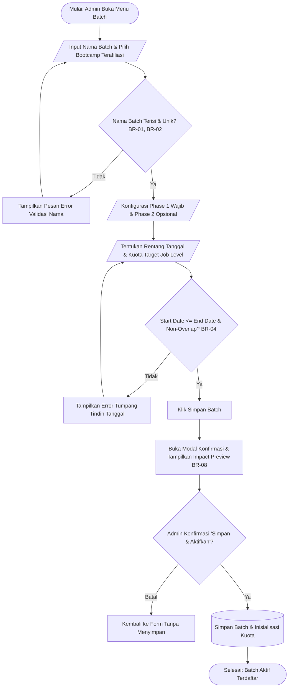
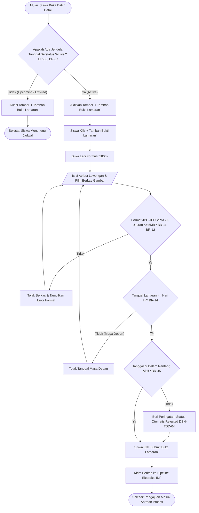
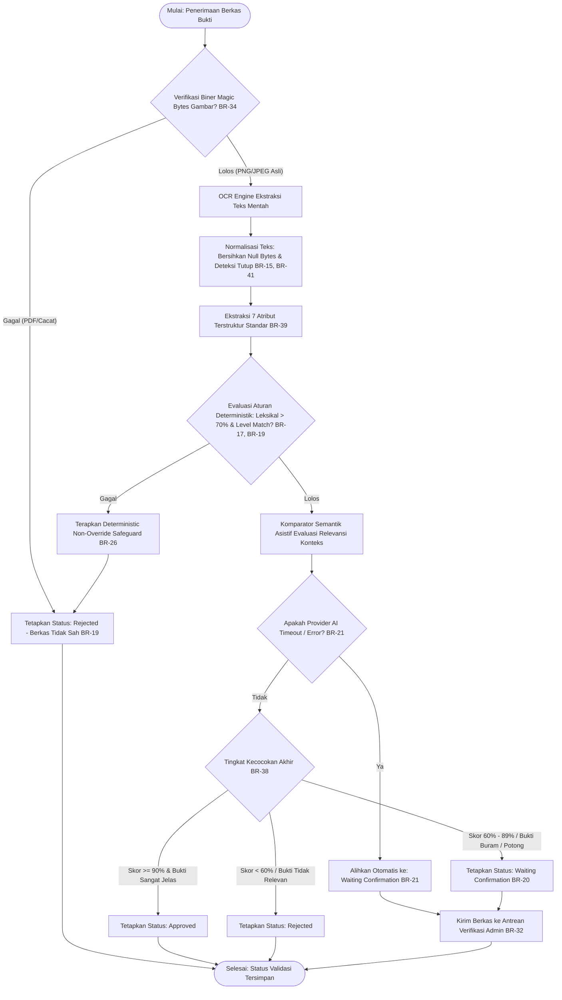
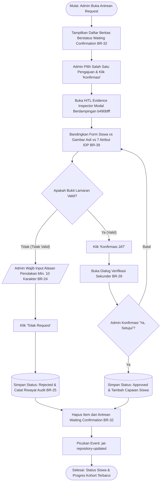

# Gambaran Sistem TO-BE (TO-BE System Overview) — JAT Hybrid IDP

**Dokumen Kontrol:**
- **ID Dokumen:** DOC-G-TOBE-07
- **Versi:** 1.0.0
- **Status:** Complete / Target Business Process Architecture
- **Klasifikasi Bukti:** Gabungan `[Documented Design/Req]`, `[Verified in Code]`, dan `[Proposed / Unresolved]`
- **Penanggung Jawab:** Senior Product Manager & Business Process Architect

---

## 1. Tujuan & Ruang Lingkup Sistem TO-BE

Sistem **Job Application Tracking (JAT) Hybrid IDP** dirancang untuk mentransformasi proses pemantauan aktivitas karir siswa dari pelaporan manual yang membebani tim pendamping menjadi sistem terotomatisasi cerdas dengan kendali mutu manusia (*Human-in-the-Loop*).

### 1.1 Batasan Fungsional Sistem (*Functional Boundaries*)
- **Fokus Utama:** Pelaporan aktivitas lamaran kerja siswa bootcamp, verifikasi otomatis bukti berkas visual menggunakan IDP, peninjauan terpusat kasus marjinal oleh Talent Support, serta agregasi capaian target kelulusan batch.
- **Pengecualian Eksplisit (*Out of Scope*):** Sistem ini **bukan** portal lowongan kerja eksternal (*job board*), bukan sistem pelacak pelamar perusahaan (*Applicant Tracking System - ATS internal HRD*), dan tidak mengotomatisasi pengiriman lamaran ke situs pihak ketiga.

---

## 2. Aktor & Tanggung Jawab Sistem

| Aktor Sistem | Peran Utama | Tanggung Jawab & Batasan Hak Akses |
|---|---|---|
| **Student (Mahasiswa/Alumni)** | Pengguna Utama Pelapor | Melihat jadwal batch terdaftar, memantau batas jendela periode aktif, mengisi formulir lamaran 8 field, mengunggah bukti gambar (JPG/JPEG/PNG <= 5MB), melihat status validasi (`Approved`, `Waiting Confirmation`, `Rejected`) beserta alasan penolakan, serta memperbarui tahap rekrutmen perusahaan secara mandiri. Siswa diblokir dari aksi administratif. |
| **Admin (Talent Support)** | Verifikator & Pembimbing | Mengonfigurasi jadwal batch, mengelola peserta, memantau kemajuan kohort makro, meninjau pengajuan berkas berstatus `Waiting Confirmation` di antrean HITL, memeriksa perbandingan bukti visual vs atribut IDP, menyetujui pengajuan atau menolak dengan alasan wajib (minimal 10 karakter), serta memicu kalkulasi ulang progres batch. |
| **Super Admin** | Pengawas Kebijakan Tertinggi | Memiliki wewenang identik dengan Admin Talent Support dalam operasional JAT, ditambah wewenang administratif lintas program dan manajemen hak akses global. |
| **Sistem Hybrid IDP (Automated Engine)** | Pemroses Dokumen Otomatis | Memvalidasi integritas biner gambar (*magic bytes*), mengekstrak 7 atribut terstruktur, memvalidasi aturan deterministik, menghitung kemiripan leksikal, mengevaluasi konteks semantik secara asistif, dan menentukan status awal pengajuan tanpa pernah membatalkan aturan deterministik (*Deterministic Non-Override*). |

---

## 3. Diagram Alur Proses Bisnis TO-BE (BPMN-Style Process Flows)

> [!NOTE]
> Seluruh diagram dimodelkan menggunakan notasi alur proses terstandar (*BPMN-style flowcharts*) dengan sintaks Mermaid. Tidak ada diagram atau terminologi UML yang digunakan.

### 3.1 Diagram Alur 1: Konfigurasi Batch oleh Admin (`PROC-01`)
*Menggambarkan alur pembuatan dan pengaktifan jadwal batch baru beserta kuota kelulusan.*

---

### 3.2 Diagram Alur 2: Pelaporan Lamaran Kerja oleh Student (`PROC-02`)
*Menggambarkan alur pemeriksaan periode dan pengisian formulir pelaporan oleh siswa.*

---

### 3.3 Diagram Alur 3: Pipeline Ekstraksi & Validasi Hybrid IDP (`PROC-03`)
*Menggambarkan mekanisme dua jalur (deterministik + semantik) dan kebijakan keputusan.*

---

### 3.4 Diagram Alur 4: Peninjauan Human-in-the-Loop oleh Admin (`PROC-04`)
*Menggambarkan alur verifikasi berkas Waiting Confirmation oleh Talent Support.*

---

## 4. Matriks Masukan & Keluaran Sistem (*Input / Output Matrix*)

| Alur Proses | Data Masukan (*Inputs*) | Validasi & Pengolahan | Data Keluaran (*Outputs*) |
|---|---|---|---|
| **Pembuatan Batch** | Nama batch, ID cohort terhubung, tanggal fase, kuota per level pekerjaan. | Cek nama unik, validasi rentang tanggal, verifikasi non-negatif. | Entitas `JatBatch` aktif dengan kuota target terinisialisasi. |
| **Pelaporan Lamaran** | Role, Perusahaan, Lokasi, Posisi, Level, Sistem Kerja, Pengalaman, URL Lowongan, Berkas Bukti PNG/JPEG. | Validasi 8 field wajib, cek ukuran <= 5MB, cek magic bytes biner, validasi tanggal lamaran. | Entitas `StudentApplicationRecord` baru berstatus `Waiting Confirmation`. |
| **Ekstraksi IDP** | Berkas biner bukti lamaran. | Sanitasi karakter kontrol, parsing OCR, pengelompokan token teks lowongan. | Objek `ExtractedJobAttributes` dengan 7 field dan skor keyakinan. |
| **Validasi IDP** | Data input form + Atribut hasil ekstraksi IDP. | Perhitungan leksikal Sørensen-Dice, aturan non-override, evaluasi semantik asistif. | Rekomendasi status validasi (`Approved` / `Waiting Confirmation` / `Rejected`) beserta temuan atribut. |
| **Review HITL** | Keputusan Admin (`Iya`/`Tidak`), alasan penolakan (jika ditolak). | Validasi panjang alasan penolakan, verifikasi sekunder persetujuan. | Pembaruan status validasi final, penambahan capaian siswa, dan pencatatan riwayat audit peninjau. |

---

## 5. Kebutuhan Non-Fungsional & Batasan Sistem

1. **Integritas Aturan Bisnis (*Business Rules Integrity*):** Aturan deterministik tanggal dan format berkas berderajat lebih tinggi daripada rekomendasi kecerdasan buatan (*deterministic precedence*).
2. **Kinerja & Kecepatan Respon (*Performance & Latency*):** Waktu respon ekstraksi dan validasi pada lingkungan produksi ditargetkan `< 3.000 ms` per berkas bukti.
3. **Keamanan & Privasi Data (*Security & Privacy*):** Berkas tangkapan layar siswa tidak boleh dikirimkan ke layanan publik tanpa perjanjian pemrosesan data (DPIA). Tidak ada kredensial API yang disematkan ke dalam repositori kode.
4. **Kejelasan Antarmuka (*Explainability & Transparency*):** Setiap hasil simulasi AI wajib mencantumkan label informasi eksplisit dan siswa berhak menerima alasan penolakan yang jelas.
