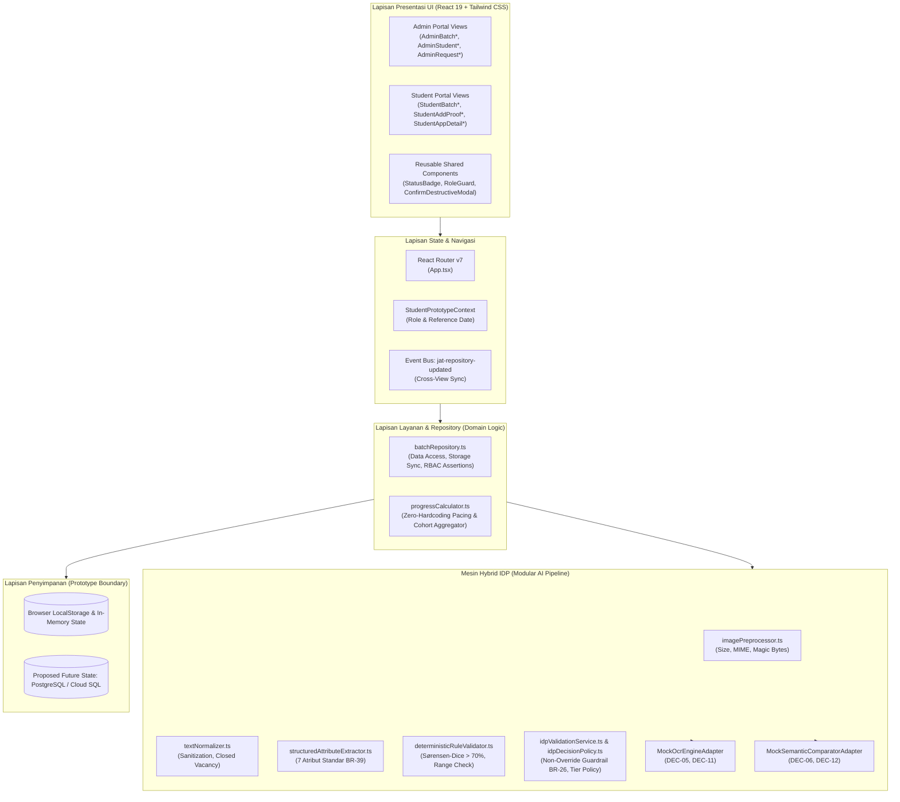

# Arsitektur Sistem & Aliran Data (Architecture & Data Flow) — JAT Hybrid IDP

**Dokumen Kontrol:**
- **ID Dokumen:** DOC-H-ARCH-08
- **Versi:** 1.0.0
- **Status:** Complete / Architecture Baseline
- **Klasifikasi Bukti:** Gabungan `[Verified in Code]`, `[Verified by Test]`, dan `[Proposed / Unresolved]`
- **Penanggung Jawab:** Software Architect & System Engineer

---

## 1. Arsitektur Komponen Tingkat Tinggi (*High-Level Component Architecture*)

Arsitektur purwarupa JAT Hybrid IDP dirancang menggunakan pola berlapis (*layered architecture*) yang memisahkan lapisan presentasi antarmuka, lapisan manajemen state, lapisan layanan bisnis, dan mesin validasi cerdas:

---

## 2. Diagram Aliran Data (Data Flow Diagram / DFD)

Diagram aliran data berikut menggambarkan bagaimana informasi bergerak dari pengguna, melalui verifikasi biner, hingga tersimpan dan disinkronkan ke seluruh antarmuka:

```mermaid
flowchart LR
  Student([Aktor: Student]) -->|1. Submit Form & File Bukti| AddProofDrawer[Laci: StudentAddProofDrawer]
  AddProofDrawer -->|2. Validasi Format Awal| Preprocessor[imagePreprocessor.ts]
  Preprocessor -->|3. Berkas Valid & Magic Bytes Sah| Pipeline[idpExtractionPipeline.ts]
  Pipeline -->|4. Parsing Teks| OcrAdapter[ocrEngine.ts - Mock Adapter]
  Pipeline -->|5. Teks Mentah Normal| Extractor[structuredAttributeExtractor.ts]
  Extractor -->|6. 7 Atribut IDP Terstruktur| ValidationSvc[idpValidationService.ts]
  ValidationSvc -->|7. Evaluasi Aturan & Kemiripan| DetermValidator[deterministicRuleValidator.ts]
  ValidationSvc -->|8. Rekomendasi Status Validasi| BatchRepository[batchRepository.ts]
  BatchRepository -->|9. Simpan Record Lamaran| LocalStorage[(LocalStorage / State)]
  BatchRepository -->|10. Munculkan Antrean| AdminQueue[AdminRequestQueuePage]
  Admin([Aktor: Admin]) -->|11. Tinjau di HITL Inspector & Putuskan| AdminQueue
  AdminQueue -->|12. Kirim Keputusan Review| BatchRepository
  BatchRepository -->|13. Hitung Ulang Capaian| ProgressCalc[progressCalculator.ts]
  BatchRepository -->|14. Emit Event Sync| EventBus[jat-repository-updated]
  EventBus -->|15. Update Otomatis Tampilan| StudentViews[Student Batch Detail & Drawers]
```

---

## 3. Matriks Komponen-ke-Berkas (*Component-to-File Mapping*)

| Nama Komponen / Modul | Berkas Sumber (*Source Path*) | Status Implementasi | Masukan (*Input*) | Keluaran (*Output*) | Dependensi Kunci | Penanganan Kegagalan (*Failure Behavior*) |
|---|---|---|---|---|---|---|
| **Router & Shell Layout** | [`src/App.tsx`](file:///c:/Users/ACER/Downloads/PKL%20Journey/jat-hybrid-idp/src/App.tsx), [`src/components/layout/*`](file:///c:/Users/ACER/Downloads/PKL%20Journey/jat-hybrid-idp/src/components/layout/) | **Real (Verified in Code)** | URL path browser, active context | Render hierarki rute Admin/Student | `react-router-dom` | Mengalihkan rute tak dikenal ke default `/admin/jat/batches`. |
| **Simulasi Peran Prototype** | [`src/context/StudentPrototypeContext.tsx`](file:///c:/Users/ACER/Downloads/PKL%20Journey/jat-hybrid-idp/src/context/StudentPrototypeContext.tsx) | **Real (Verified in Code)** | Pilihan peran pengguna di header | State `actorRole` dan `referenceDate` | React Context API | Default fallback ke `'Admin (Talent Support)'`. |
| **Repository & Data Access** | [`src/services/batchRepository.ts`](file:///c:/Users/ACER/Downloads/PKL%20Journey/jat-hybrid-idp/src/services/batchRepository.ts) | **Real (Verified in Code)** | Request mutasi batch, student, dan lamaran | Entitas data terupdate, persistensi storage | `localStorage`, CustomEvent | Fallback ke dataset mock awal (`INITIAL_MOCK_*`) bila storage gagal. |
| **Mesin Kalkulasi Progres** | [`src/services/progressCalculator.ts`](file:///c:/Users/ACER/Downloads/PKL%20Journey/jat-hybrid-idp/src/services/progressCalculator.ts) | **Real (Verified in Code)** | Objek `JatBatch` dan array `StudentApplicationRecord` | `BatchMonitoringSummary`, capaian kuota | `dateUtils.ts` | Mengembalikan nilai 0 jika kapasitas cohort bernilai 0 (anti divide-by-zero). |
| **Image Preprocessor** | [`src/services/idp/imagePreprocessor.ts`](file:///c:/Users/ACER/Downloads/PKL%20Journey/jat-hybrid-idp/src/services/idp/imagePreprocessor.ts) | **Real (Verified in Code)** | Metadata berkas & array biner header | Objek `ImageValidationResult` (valid, format, MIME) | None | Menolak berkas palsu/rusak dengan error code spesifik (`CORRUPT_BYTES`, dll). |
| **Text Normalizer** | [`src/services/idp/textNormalizer.ts`](file:///c:/Users/ACER/Downloads/PKL%20Journey/jat-hybrid-idp/src/services/idp/textNormalizer.ts) | **Real (Verified in Code)** | String teks mentah | Teks tersanitasi & boolean `isClosedVacancy` | Regex | Mengabaikan karakter kontrol tak terlihat dan menormalkan whitespace. |
| **Attribute Extractor** | [`src/services/idp/structuredAttributeExtractor.ts`](file:///c:/Users/ACER/Downloads/PKL%20Journey/jat-hybrid-idp/src/services/idp/structuredAttributeExtractor.ts) | **Real (Verified in Code)** | Array blok teks OCR | Objek `ExtractedJobAttributes` dengan 7 field | None | Atribut yang tidak terdeteksi visual diset `null` / `unknown` (`BR-18`). |
| **OCR Engine Adapter** | [`src/services/idp/ocrEngine.ts`](file:///c:/Users/ACER/Downloads/PKL%20Journey/jat-hybrid-idp/src/services/idp/ocrEngine.ts) | **Mock Adapter (DEC-05)** | Berkas bukti lamaran | Array blok OCR sintetis beranotasi | `syntheticExtractionFixtures.ts` | Jika fixture bernilai `PROVIDER_FAILURE`, melempar error timeout terkontrol. |
| **Leksikal Sørensen-Dice** | [`src/services/idp/lexicalSimilarity.ts`](file:///c:/Users/ACER/Downloads/PKL%20Journey/jat-hybrid-idp/src/services/idp/lexicalSimilarity.ts) | **Real (Verified in Code)** | Dua string teks (form vs bukti) | Skor desimal `0.0` s/d `1.0` | None | Membersihkan prefiks badan hukum (PT/CV/Tbk) sebelum menghitung bi-gram. |
| **Deterministic Validator** | [`src/services/idp/deterministicRuleValidator.ts`](file:///c:/Users/ACER/Downloads/PKL%20Journey/jat-hybrid-idp/src/services/idp/deterministicRuleValidator.ts) | **Real (Verified in Code)** | Form input vs Atribut ekstraksi IDP | `DeterministicValidationResult` | `lexicalSimilarity.ts` | Menandai `passed: false` jika role/company < 70% atau level/pengalaman mismatch. |
| **Semantic Comparator Adapter** | [`src/services/idp/semanticComparator.ts`](file:///c:/Users/ACER/Downloads/PKL%20Journey/jat-hybrid-idp/src/services/idp/semanticComparator.ts) | **Mock Adapter (DEC-06)** | Form input vs Atribut ekstraksi IDP | Skor kecocokan semantik & penalaran | Typed contracts | Jika fixture bernilai failure, mengembalikan error terstruktur tanpa crash. |
| **IDP Decision Orchestrator** | [`src/services/idp/idpValidationService.ts`](file:///c:/Users/ACER/Downloads/PKL%20Journey/jat-hybrid-idp/src/services/idp/idpValidationService.ts) | **Real (Verified in Code)** | Form input, berkas bukti, fixture ID | Objek `IdpValidationResult` final | `idpDecisionPolicy.ts` | **Non-Override Guard:** Jika deterministik gagal, status dipaksa `Rejected` (`BR-26`). |

---

## 4. Tabel Kepemilikan Data & Sumber Kebenaran (*Data Ownership & Source-of-Truth*)

Untuk menghindari konflik data antarmuka, sumber kebenaran data diatur secara terpusat:

| Entitas Data | Sumber Kebenaran Utama (*Single Source of Truth*) | Aturan Pembaruan (*Update Policy*) | Konsumen Data (*Consumers*) |
|---|---|---|---|
| **Konfigurasi Batch & Jadwal** | Array `this.batches` di `batchRepository.ts` | Hanya dapat diubah oleh Admin dengan otorisasi (`assertAdminAccess`). Perubahan memicu pratinjau konsekuensi (`BR-08`). | `AdminBatchManagementPage`, `AdminBatchDetailPage`, `StudentBatchListPage`, `StudentBatchDetailPage`. |
| **Arsip Data Lamaran Siswa** | Array `this.applications` di `batchRepository.ts` | Bertambah saat Siswa submit. Status validasi hanya berubah melalui validasi awal IDP atau keputusan Admin HITL. Tidak pernah dihapus otomatis saat peserta dikeluarkan (`BR-10`). | `StudentApplicationDetailDrawer`, `AdminStudentDetailPage`, `AdminRequestQueuePage`, `AdminAppliedJobsSection`. |
| **Batas Waktu Validitas Pengajuan** | Kolom `submittedDateRangeWindow` pada `StudentApplicationRecord` | Di-snapshot otomatis saat Siswa melakukan submit (`BR-42`). Perubahan rentang tanggal batch di masa depan oleh Admin tidak membatalkan lamaran yang sudah valid. | `progressCalculator.ts`, `StudentBatchDetailPage`. |
| **Angka Capaian & Ringkasan Progres** | Hasil komputasi murni dari `progressCalculator.ts` | Dikalkulasi secara *on-the-fly* dari data batch dan lamaran berstatus `Approved`. Tidak ada angka statis yang disimpan langsung di komponen UI. | Top KPI Summary Cards, Progress Bars, Monitoring Widgets. |
| **Hasil Ekstraksi & Temuan IDP** | Kolom `validationFindings` dan `validationSource` pada `StudentApplicationRecord` | Disimpan bersama record pengajuan. Menyimpan data temuan per atribut tanpa menyimpan raw chain-of-thought (`AGENTS.md`). | `AdminHitlInspectorModal`, `StudentApplicationDetailDrawer`. |
| **Riwayat Peninjauan Manusia** | Array `reviewHistory` pada `StudentApplicationRecord` | Ditambahkan secara append-only setiap kali Admin melakukan review (`BR-25`). Menyimpan keputusan, alasan, peninjau, dan timestamp. | `AdminHitlInspectorModal`, `StudentApplicationDetailDrawer`. |
